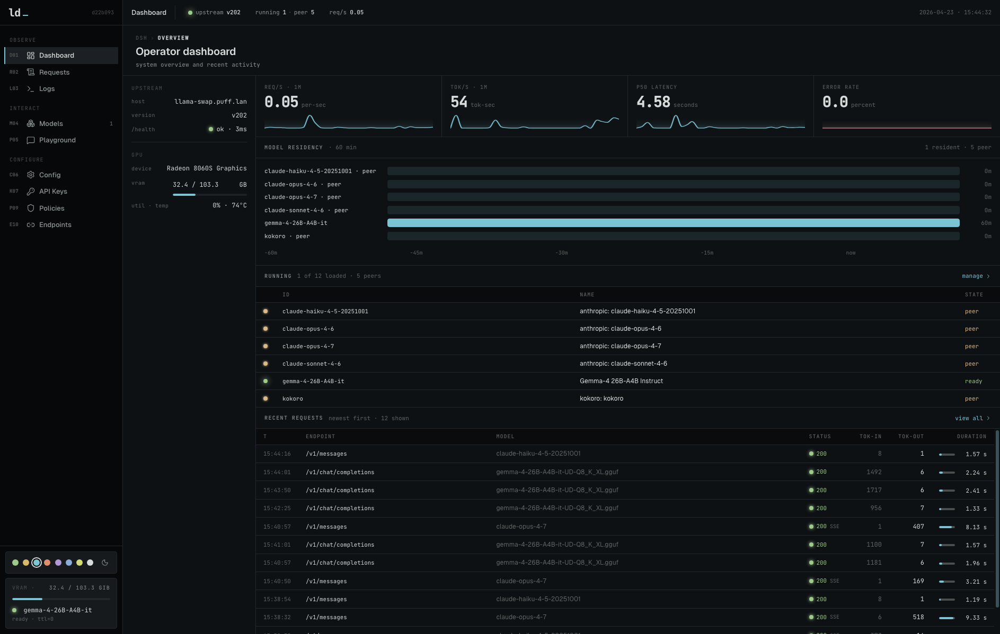
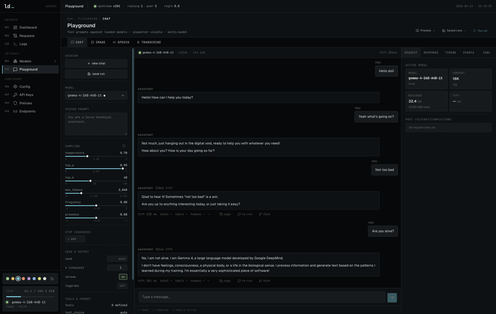
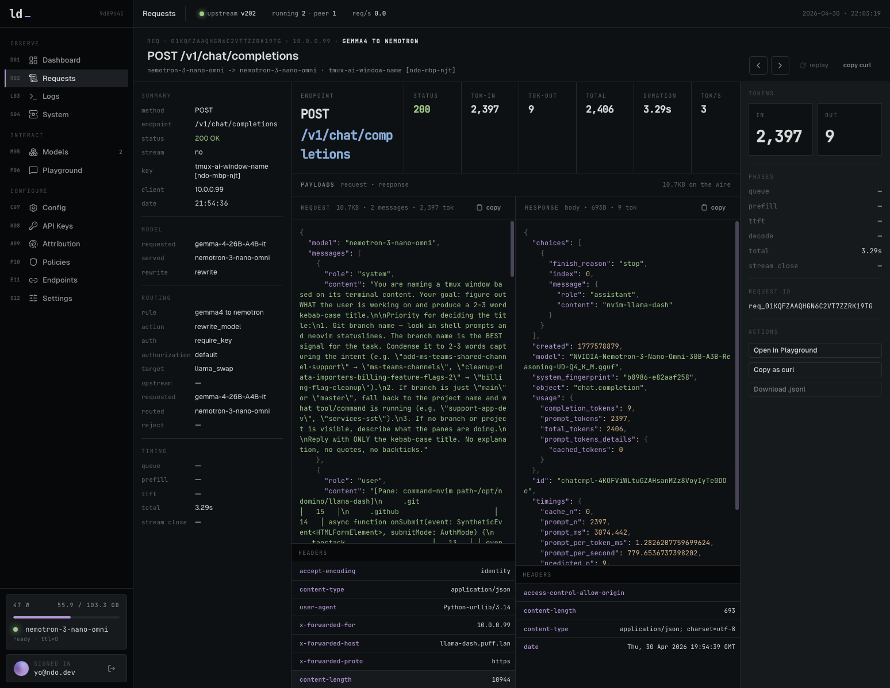
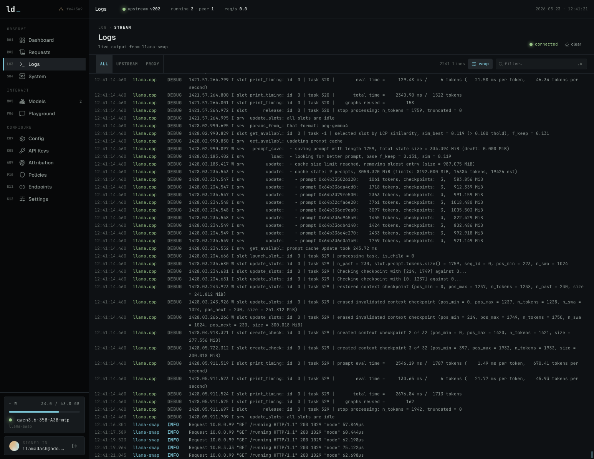
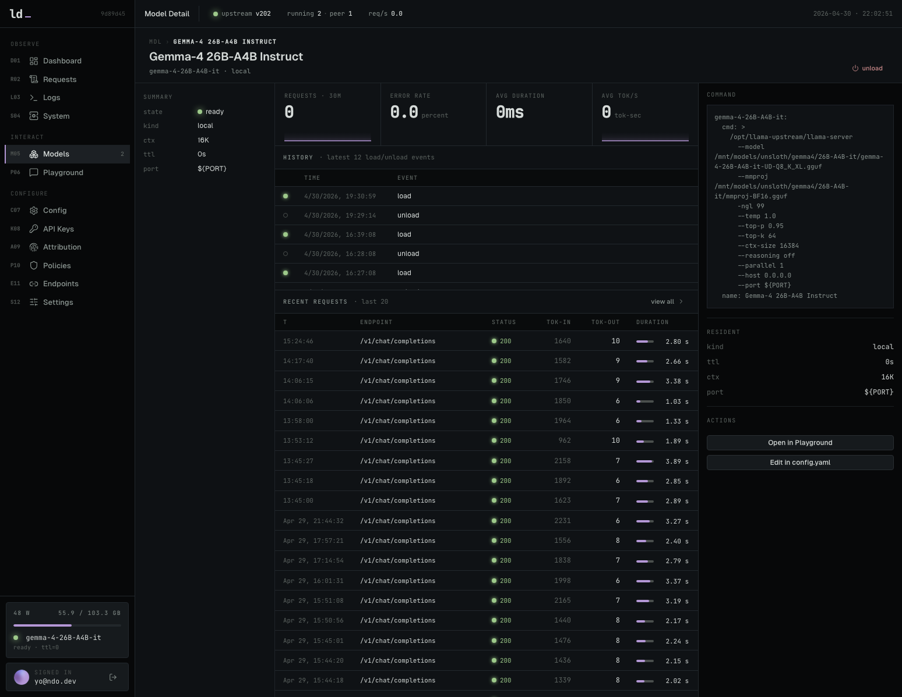
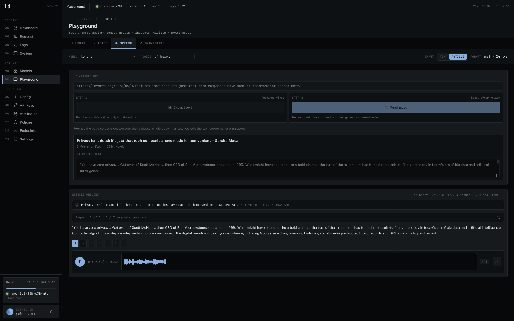
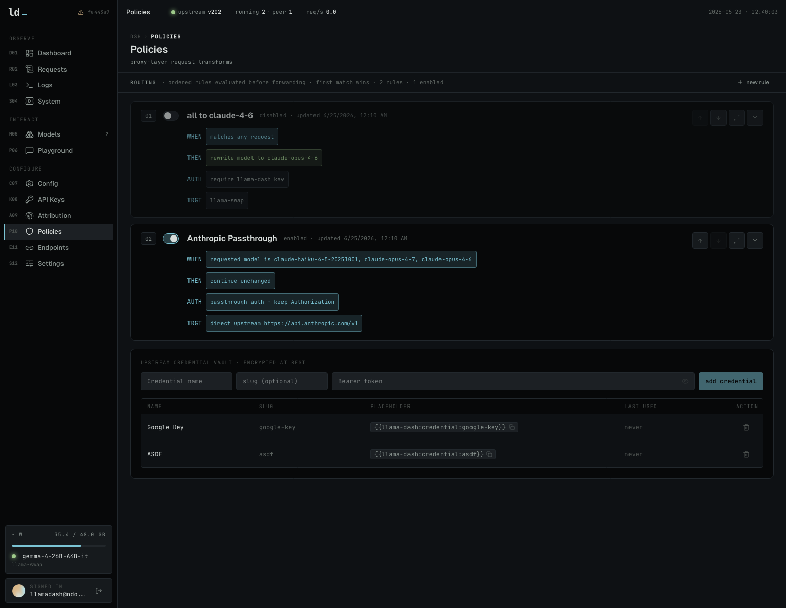
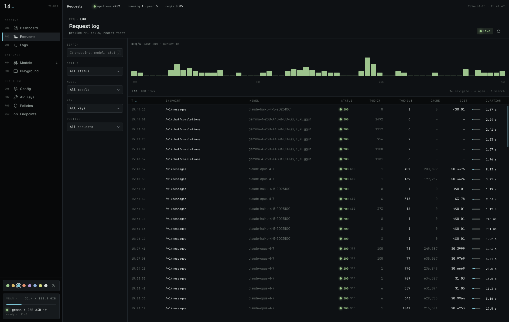

<h1>
  
  &nbsp;llama-dash
</h1>



llama-dash turns a self-hosted local inference box into an observable, policy-controlled AI gateway: one UI for model state, request history, API keys, routing rules, proxy metrics, and client setup. The implemented inference backend is currently [llama-swap](https://github.com/mostlygeek/llama-swap) over llama.cpp.

It is the single public entrypoint for OpenAI-compatible and Anthropic-compatible clients. llama-dash owns proxy policy, logging, auth, routing, and backend normalization, your selected inference backend owns local model processes and inference when traffic is routed to local models.

```text
OpenAI SDK / Claude Code / Continue / Open WebUI
                    │
                    ▼
              llama-dash :3000
      dashboard · auth · logs · routing · metrics
             │                     │
             ▼                     ▼
      llama-swap :8080         direct /v1 upstreams
  llama.cpp models · peers      OpenAI · Anthropic
```

## ✨ What it does

- Monitor traffic, token usage, models, and CPU/GPU health in one dashboard.
- Browse request history with filters, timing, attribution, token counts, and cost estimates. Usage rollups persist beyond raw request retention.
- Load and unload models, inspect their capabilities and history, and edit validated llama-swap configuration.
- Proxy OpenAI and Anthropic clients to local models, peers, or direct upstreams; native llama.cpp and llama-swap audio endpoints are supported too.
- Control access with dashboard login, API keys, rate limits, model permissions, and MCP relay allow-lists.
- Route or reject requests, rewrite models, inject credentials and system prompts, and set request size limits.
- Test chat, image, speech, and transcription models in the playground.
- View logs, manage retention, and export Prometheus metrics at `/metrics`.
- Navigate with keyboard shortcuts, including `g d` for the dashboard and `g r` for requests.

<table>
  <tr>
    <td align="center" valign="top">
      <sub><strong>Dashboard</strong><br />Live traffic, tokens, model residency, upstream and GPU health</sub>
    </td>
    <td align="center" valign="top">
      <sub><strong>Playground</strong><br />Chat against local endpoints with request/response inspection</sub>
    </td>
    <td align="center" valign="top">
      <sub><strong>Request detail</strong><br />Routing, attribution, latency, tokens, and payload metadata</sub>
    </td>
    <td align="center" valign="top">
      <sub><strong>Logs</strong><br />Raw llama-swap, proxy, and upstream streams in one viewer</sub>
    </td>
  </tr>
  <tr>
    <td valign="top">
      
    </td>
    <td valign="top">
      
    </td>
    <td valign="top">
      
    </td>
    <td valign="top">
      
    </td>
  </tr>
  <tr>
    <td align="center" valign="top">
      <sub><strong>Model detail</strong><br />Load history, stats, recent requests, and config context</sub>
    </td>
    <td align="center" valign="top">
      <sub><strong>Speech playground</strong><br />Read any article and audio testing</sub>
    </td>
    <td align="center" valign="top">
      <sub><strong>Policies</strong><br />Aliases, routing rules, passthrough auth, and request limits</sub>
    </td>
    <td align="center" valign="top">
      <sub><strong>Requests</strong><br />Searchable history with filters, sorting, and histogram</sub>
    </td>
  </tr>
  <tr>
    <td valign="top">
      
    </td>
    <td valign="top">
      
    </td>
    <td valign="top">
      
    </td>
    <td valign="top">
      
    </td>
  </tr>
</table>


## ⚡ Quick start (Docker Compose)

Choose the compose file that matches your GPU vendor. Both setups pull the published `ghcr.io/ndom91/llama-dash:latest` image, use `./config/config.yaml` for llama-swap config, mount `./models/` for model files, and expose llama-dash on `http://localhost:3000`.

Clone the repository for its Compose files and example configuration, then create the local environment and llama-swap config:

```bash
git clone https://github.com/ndom91/llama-dash.git
cd llama-dash
cp .env.example .env
cp config/config.example.yaml config/config.yaml
```

Set `BETTER_AUTH_SECRET` in `.env` to the output of `openssl rand -base64 33`. The compose files load `.env` via `env_file` and won't start without it. `CREDENTIAL_ENCRYPTION_KEY` is only needed if you later store upstream provider credentials.

Place a GGUF model in `./models/`, then set the matching path and model ID in `config/config.yaml`. The supplied example expects `./models/llama-3.gguf` and declares it as `llama3`.

### AMD / ROCm

```bash
docker compose -f docker-compose.amd.yaml pull
docker compose -f docker-compose.amd.yaml up -d
```

`docker-compose.amd.yaml` runs `ghcr.io/mostlygeek/llama-swap:rocm`, passes through `/dev/kfd` and `/dev/dri`, and also mounts `/dev/dri` into llama-dash so AMD GPU stats work in the dashboard. The config directory is mounted into both services so llama-dash can atomically save `config.yaml` and llama-swap can reload it through `-watch-config`.

### NVIDIA / CUDA

```bash
docker compose -f docker-compose.nvidia.yaml pull
docker compose -f docker-compose.nvidia.yaml up -d
```

`docker-compose.nvidia.yaml` runs `ghcr.io/mostlygeek/llama-swap:cuda` and requests `gpus: all` for the llama-swap service. This requires the NVIDIA Container Toolkit on the host. The config directory is mounted into both services so llama-dash can atomically save `config.yaml` and llama-swap can reload it through `-watch-config`.

Set `LLAMA_DASH_IMAGE_TAG` to a [published image tag](https://github.com/ndom91/llama-dash/pkgs/container/llama-dash), such as a commit SHA tag, to pin llama-dash to a specific build. Contributors can build locally instead by adding `-f docker-compose.build.yaml` and `--build` to either command, for example:

```bash
docker compose -f docker-compose.amd.yaml -f docker-compose.build.yaml up -d --build
```

Open `http://localhost:3000`, create the first dashboard user, then load your configured model from **Models**. llama-dash runs database migrations automatically when it starts.

## 🏗️ Manual setup

### Requirements

- Node 24+
- pnpm
- A reachable [llama-swap](https://github.com/mostlygeek/llama-swap) instance

### Install

```bash
cp .env.example .env   # edit INFERENCE_BASE_URL to point at your instance
pnpm install
pnpm db:migrate        # creates data/dash.db
pnpm dev               # http://localhost:5173
```

## 🏔️ Environment

Copy `.env.example` to `.env` and fill in the values.

See the [environment variables reference](https://llama-dash.dev/docs/reference/environment-variables)
for the complete list of variables, defaults, and deployment notes.

## ✴️ Claude Code / Anthropic passthrough

Route any Anthropic SDK, including Claude Code, through llama-dash for logging,
filtering, per-request inspection, and Anthropic subscription passthrough.

See the [Claude Code & Anthropic passthrough guide](https://llama-dash.dev/docs/clients/claude-code)
for client setup, routing rules, subscription OAuth, and provider-key flows. For
remote MCP servers, see the [MCP relays guide](https://llama-dash.dev/docs/clients/mcp-relays).

## 🤖 Acknowledgements

This project was developed with significant assistance from LLMs. Architecture decisions, implementation, and documentation were all shaped through human-AI collaboration.

## 📝 License

MIT
