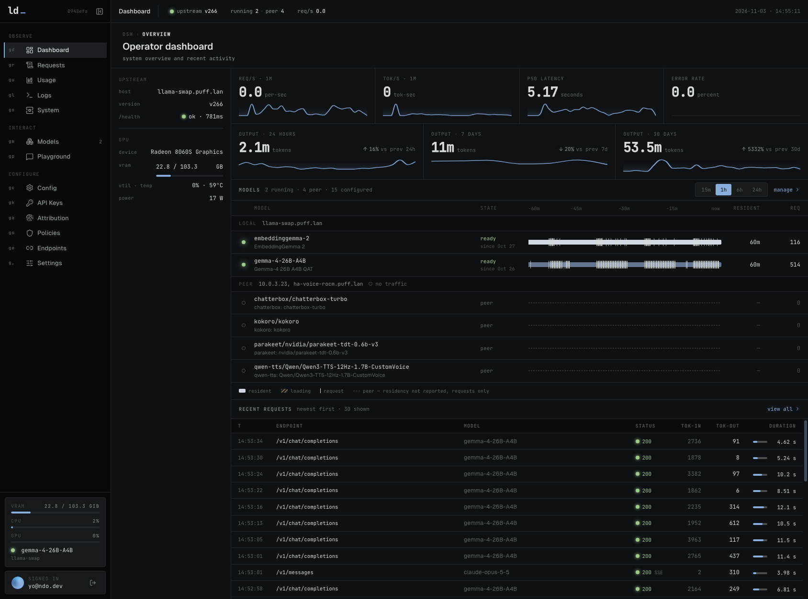
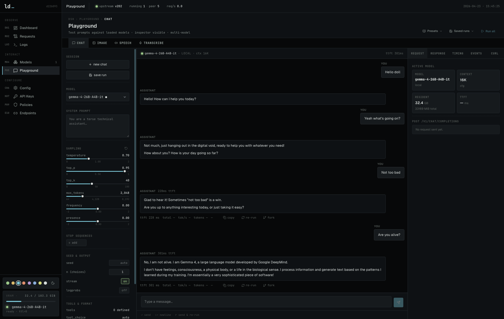
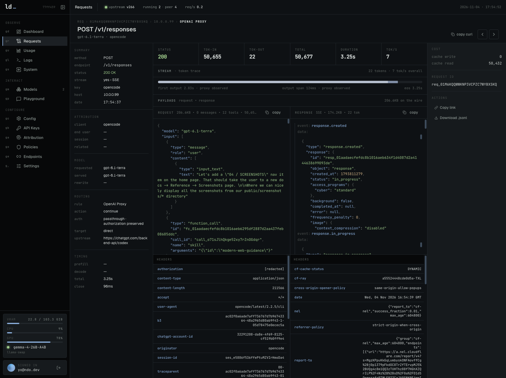
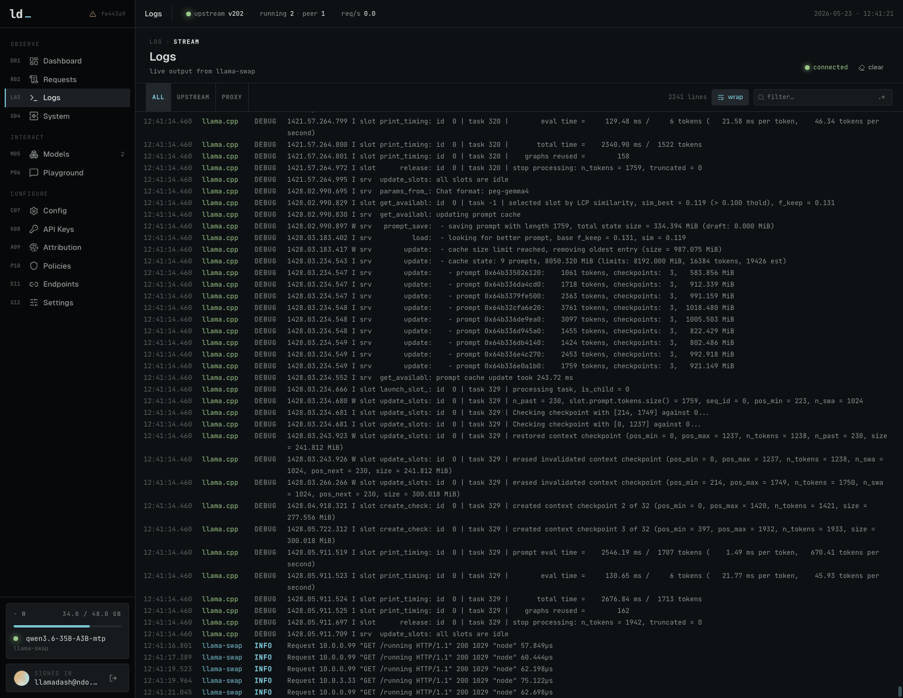
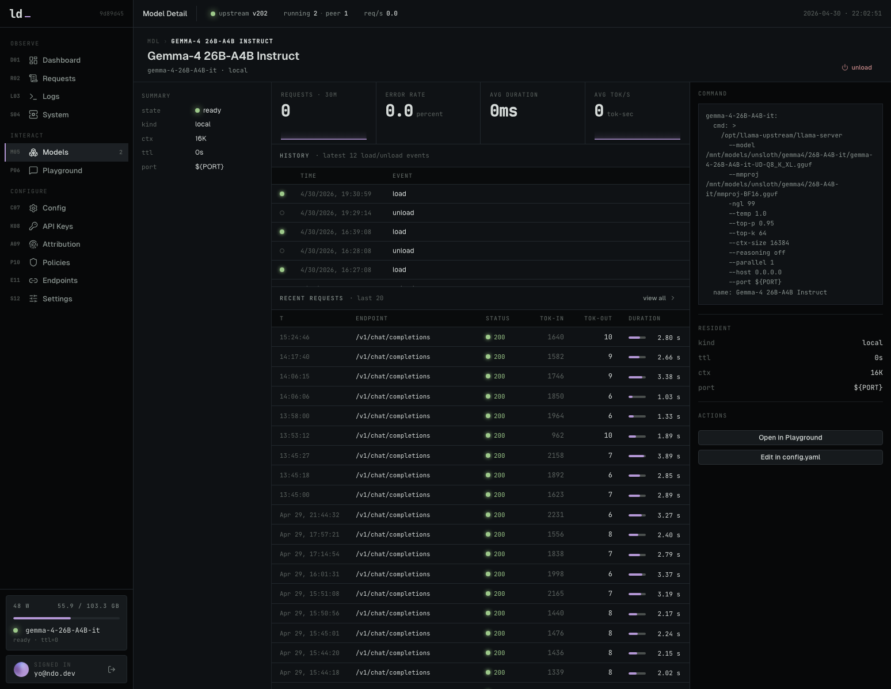
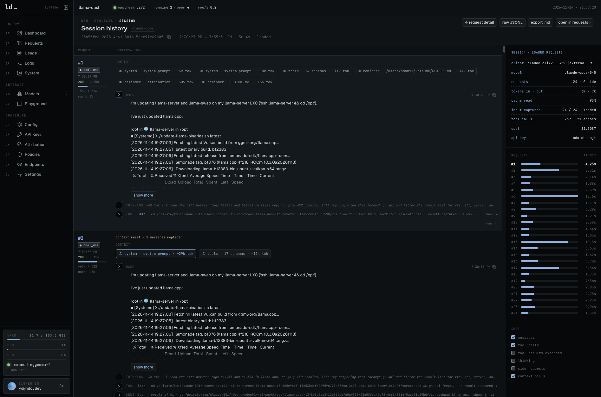
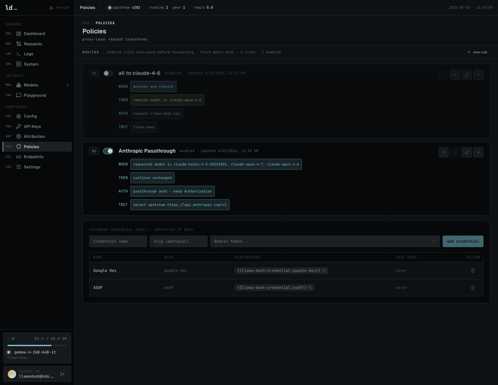
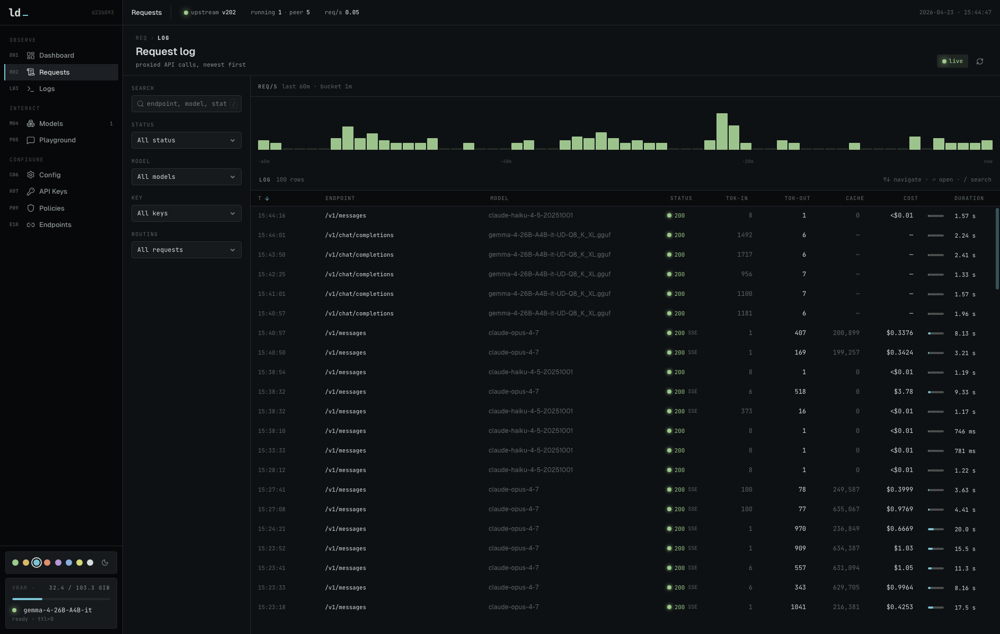

<h1>
  
  &nbsp;llama-dash
</h1>

llama-dash is a dashboard and API gateway for your self-hosted [llama-swap](https://github.com/mostlygeek/llama-swap) + llama.cpp stack. Manage models, inspect requests, and control client access from one place.



[Quick start](#quick-start-docker-compose) · [Manual setup](#manual-setup) · [Client setup](#client-setup) · [Documentation](https://llama-dash.dev/docs)


```text
OpenAI SDK / Claude Code / Continue / Open WebUI
                    │
                    ▼
              llama-dash :3000
      dashboard · auth · logs · routing · metrics
             │                     │
             ▼                     ▼
      llama-swap :8080         direct /v1 upstreams
  llama.cpp models · peers      OpenAI · Anthropic
```

## What it does

- Monitor traffic, token usage, cost estimates, and CPU/GPU health.
- Inspect request history with filters, sorting, shareable time ranges, payloads, and timing details. Usage rollups outlive raw request logs.
- Load and unload models, inspect capabilities and history, pause inference (llama-swap v268+), and edit validated configuration.
- Control access with dashboard login, API keys, rate limits, model permissions, and MCP relay allow-lists.
- Route requests to local models, peers, or direct upstreams. Rewrite model names, reject requests, inject credentials or system prompts, and limit request sizes.
- Test chat, image, speech, transcription, and realtime voice models in the playground.


<table>
  <tr>
    <td align="center" valign="top">
      <sub><strong>Dashboard</strong><br />Live traffic, tokens, model residency with per-request ticks, upstream and GPU health</sub>
    </td>
    <td align="center" valign="top">
      <sub><strong>Playground</strong><br />Chat against local endpoints with request/response inspection</sub>
    </td>
    <td align="center" valign="top">
      <sub><strong>Request detail</strong><br />Routing, attribution, latency, tokens, and payload metadata</sub>
    </td>
    <td align="center" valign="top">
      <sub><strong>Logs</strong><br />Raw llama-swap, proxy, and upstream streams in one viewer</sub>
    </td>
  </tr>
  <tr>
    <td valign="top">
      
    </td>
    <td valign="top">
      
    </td>
    <td valign="top">
      
    </td>
    <td valign="top">
      
    </td>
  </tr>
  <tr>
    <td align="center" valign="top">
      <sub><strong>Model detail</strong><br />Load history, stats, recent requests, weights size, and config context</sub>
    </td>
    <td align="center" valign="top">
      <sub><strong>Session History</strong><br />View detailed session history</sub>
    </td>
    <td align="center" valign="top">
      <sub><strong>Policies</strong><br />Aliases, routing rules, passthrough auth, and request limits</sub>
    </td>
    <td align="center" valign="top">
      <sub><strong>Requests</strong><br />Searchable history with filters, sorting, and histogram</sub>
    </td>
  </tr>
  <tr>
    <td valign="top">
      
    </td>
    <td valign="top">
      
    </td>
    <td valign="top">
      
    </td>
    <td valign="top">
      
    </td>
  </tr>
</table>


## Quick start (Docker Compose)

The bundled stack runs llama-dash and llama-swap, with the dashboard and client API at `http://localhost:3000`. Choose AMD/Vulkan or NVIDIA/CUDA below. Both use the published `ghcr.io/ndom91/llama-dash:latest` image.

### 1. Copy the configuration

```bash
git clone https://github.com/ndom91/llama-dash.git
cd llama-dash
cp .env.example .env
cp config/config.example.yaml config/config.yaml
```

### 2. Set the secret and model

- Set `BETTER_AUTH_SECRET` in `.env` to the output of `openssl rand -base64 33`. Compose loads `.env` and won't start without this secret.
- Place a GGUF model in `./models/` and update its path and model ID in `config/config.yaml`. The example expects `./models/llama-3.gguf` with the ID `llama3`.
- If you plan to store upstream provider credentials, also set `CREDENTIAL_ENCRYPTION_KEY` in `.env`.

### 3. Start the stack

#### AMD / Vulkan

```bash
docker compose -f docker-compose.amd.yaml pull
docker compose -f docker-compose.amd.yaml up -d
```

Uses llama-swap's `unified-vulkan` image. The stack passes `/dev/dri` to both services for inference and dashboard GPU stats.

#### NVIDIA / CUDA

Requires the NVIDIA Container Toolkit on the host.

```bash
docker compose -f docker-compose.nvidia.yaml pull
docker compose -f docker-compose.nvidia.yaml up -d
```

Uses llama-swap's `unified-cuda13` image with `gpus: all`. It supports Turing (RTX 20xx, GTX 16xx) and newer GPUs. For Pascal cards such as the GTX 10xx or P40, change the llama-swap image to `ghcr.io/mostlygeek/llama-swap:unified-cuda`.

### 4. Open the dashboard

Open `http://localhost:3000`, create the first dashboard user, then load your model from **Models**. llama-dash runs database migrations automatically at startup.

<details>
<summary>Image versions, local builds, and config reloads</summary>

Set `LLAMA_DASH_IMAGE_TAG` in `.env` to a [published image tag](https://github.com/ndom91/llama-dash/pkgs/container/llama-dash), such as a commit SHA tag, to pin a specific build.

To build locally, add `-f docker-compose.build.yaml` and `--build` to either vendor's `up` command:

```bash
docker compose -f docker-compose.amd.yaml -f docker-compose.build.yaml up -d --build
```

Both setups use llama-swap's [unified containers](https://github.com/mostlygeek/llama-swap#unified-container-recommended) and share the `./config/` directory between services. This lets llama-dash save `config.yaml` atomically and llama-swap reload it with `-watch-config`. Model files are mounted from `./models/`.

</details>

## Manual setup

For an existing llama-swap instance, install **Node 24+** and **pnpm**, then run these commands from the repository:

```bash
cp .env.example .env   # edit INFERENCE_BASE_URL to point at your instance
pnpm install
pnpm db:migrate        # creates data/dash.db
pnpm dev               # http://localhost:5173
```

See the [environment variables reference](https://llama-dash.dev/docs/reference/environment-variables) for all variables, defaults, and deployment notes.

## Client setup

The **Endpoints** page has connection examples for curl, Python, TypeScript, Home Assistant, Claude Code, opencode, Continue, and Open WebUI.

See the [Claude Code & Anthropic passthrough guide](https://llama-dash.dev/docs/clients/claude-code) for proxy setup.

## Acknowledgements

This project was developed with significant assistance from LLMs. Architecture decisions, implementation, and documentation were all shaped through human-AI collaboration.

## License

MIT
